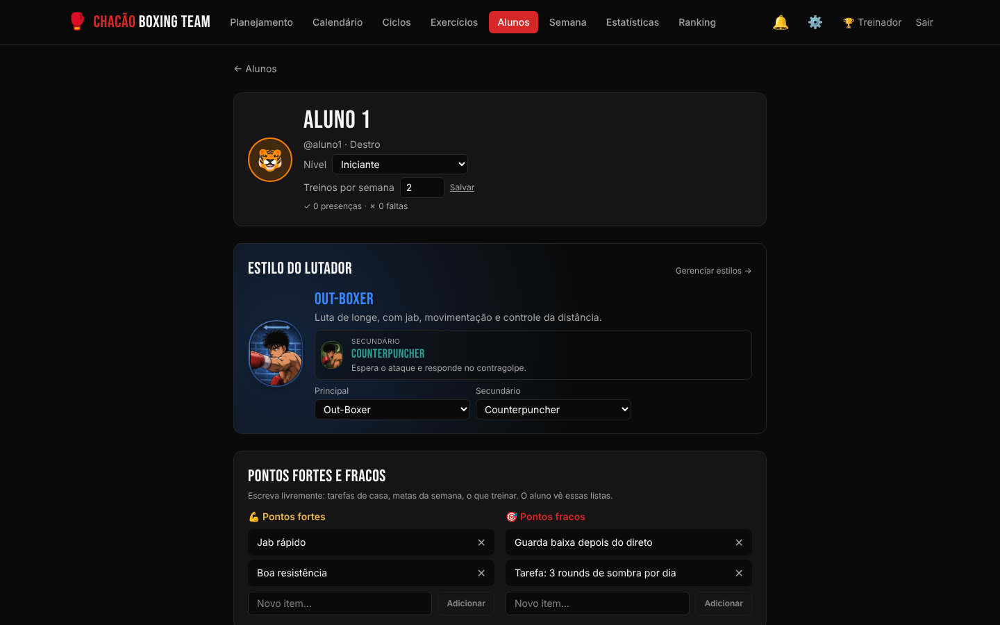
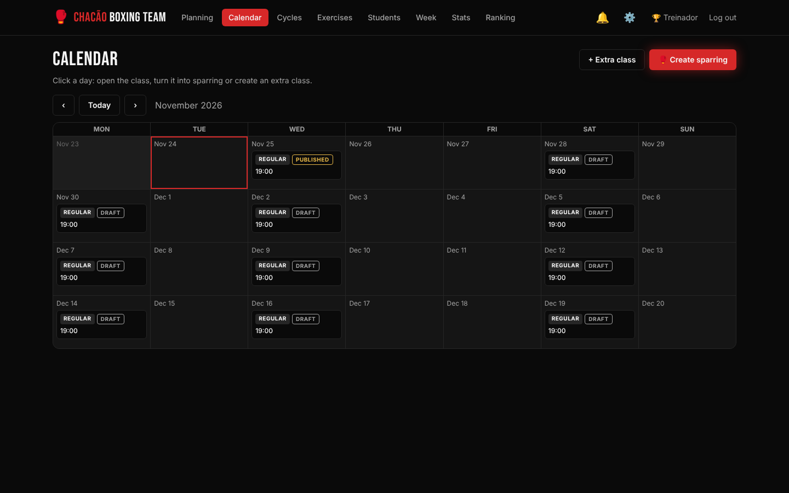
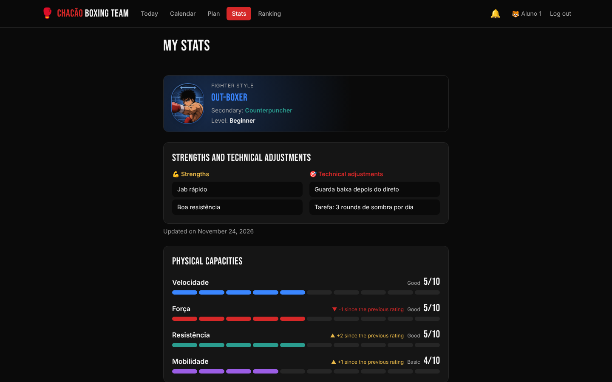

<div align="center">

# 🥊 Kamogawa Dashboard

**Boxing training dashboard for coaches and their students.**

Plan periodized training, build each class from an exercise library, and follow every fighter's progress.

[](https://github.com/kundlatsch/kamogawa-dashboard/actions/workflows/ci-cd.yml)


[](./LICENSE)

[Features](#features) · [Getting started](#getting-started) · [Deployment](#deployment) · [Contributing](#contributing) · [License](#license)


</div>

## About

Kamogawa Dashboard runs the day-to-day of a boxing gym. The coach plans the season in cycles, builds each class by dragging exercises onto the students who checked in, and keeps each fighter's style, stats and goals up to date. Students check in, see their class and follow their own progress.

It supports several gyms on one install, each with its own coaches, students and data. The first gym using it is **Chacão Boxing Team**. The UI is in English and Brazilian Portuguese.

## Features

**For coaches**
- **Planning board:** the next class split into blocks (mobility, warm-up, boxing school, combat, cool-down). Drag exercises onto one student, a pair, a group or everyone. Each column shows the fighter's style, strengths, weaknesses, stance and limitations.
- **Calendar and cycles:** regular classes from the weekly schedule, sparring days, extra or cancelled classes, and macro, meso and microcycles that give every class its objective.
- **Student profile:** level, main and secondary fighter style, free-text strengths, weaknesses and focuses, and coach notes.
- **Student stats:** a score per skill on a configurable scale, with a rating guide from beginner to competition level.
- **Attendance and ranking:** check-ins, weekly absences closed automatically every Sunday, and an attendance ranking.

**For students**
- Check in to any upcoming class and report pain or injuries.
- See today's class, the training plan, their stats with history, and the ranking.

**Languages**
- The interface is available in English and Portuguese and follows the browser's language by default.
- Every user (account admin, coach or student) can pick a language in **My profile**, and the choice follows them to any device.
- The home and login pages have an EN | PT switch.
- When the browser's language isn't supported, the install default from `DEFAULT_LANGUAGE` is used.

<table>
  <tr>
    <td></td>
    <td></td>
  </tr>
  <tr>
    <td></td>
    <td></td>
  </tr>
</table>

## Built with

| Layer | Stack |
|---|---|
| Frontend | React 18, TypeScript, Vite, Tailwind CSS 4, TanStack Query, dnd-kit, react-i18next |
| Backend | Django 5.2, Django REST Framework, SimpleJWT |
| Database | PostgreSQL 16 |
| Infrastructure | Docker Compose, nginx, gunicorn, GitHub Actions, GHCR, Watchtower |

## Getting started

You only need [Docker](https://docs.docker.com/get-docker/) with Compose v2.24 or newer.

```bash
git clone https://github.com/kundlatsch/kamogawa-dashboard.git
cd kamogawa-dashboard
cp .env.example .env          # set passwords and a secret key
docker compose up -d --build
```

Open **http://localhost:5180**. The API runs on http://localhost:8010/api/, and migrations run on start. On first boot, an account admin is created from `ADMIN_USERNAME` and `ADMIN_PASSWORD` in `.env`.

### Configuration

All settings live in `.env` (see [`.env.example`](./.env.example)). Besides passwords and the secret key:

| Variable | Default | What it does |
|---|---|---|
| `DEFAULT_LANGUAGE` | `en` | Interface language when the browser's language isn't supported and the user hasn't picked one. Supported: `en`, `pt-BR`. |
| `TZ` | | Server time zone, used by the weekly absence job. |

### Test data

```bash
docker compose exec backend python manage.py seed_test
```

This creates a gym with known logins: the coach `treinador` / `treinador` and the students `aluno1` / `aluno1` to `aluno4` / `aluno4`. It also adds exercises and plans the next class. Use it only on test installs, because these passwords are public.

To add the bundled library of about 380 exercises (in Portuguese, grouped into 8 categories) to any gym:

```bash
docker compose exec backend python manage.py import_exercises --gym <gym-slug>
```

It skips exercises the gym already has, so it is safe to run again. `--file` loads another library in the same format.

### Running the tests

```bash
docker compose exec backend pytest
docker compose exec frontend npm test
```

## Deployment

Every push to `main` runs the tests and publishes the backend and frontend images to GitHub Container Registry. The server runs [`docker-compose.prod.yml`](./docker-compose.prod.yml), and Watchtower pulls new images on its own. The server needs no source code and no inbound connection from GitHub.

See the step-by-step **[server setup guide](./docs/server-setup.md)**.

## Contributing

Issues and pull requests are welcome. Before opening a pull request:

1. Keep commits small and focused, with [conventional](https://www.conventionalcommits.org/) messages (`feat:`, `fix:`, `docs:`).
2. Write code, comments and docs in English. UI text goes in `frontend/src/i18n/locales/`, never in components.
3. Make sure both test suites pass.

To add a language:

1. Copy `frontend/src/i18n/locales/en.json` to `<code>.json` (for example `es.json`) and translate the values.
2. Register it in `frontend/src/i18n/index.ts`.
3. Add release notes in `frontend/src/changelog/<code>.json` and register them in `frontend/src/lib/changelog.ts`.
4. Add the code to `UI_LANGUAGES` in `backend/config/settings.py`.

## Author

Developed by **[Taguma](https://github.com/kundlatsch)**.

## License

Distributed under the MIT License. See [`LICENSE`](./LICENSE).
